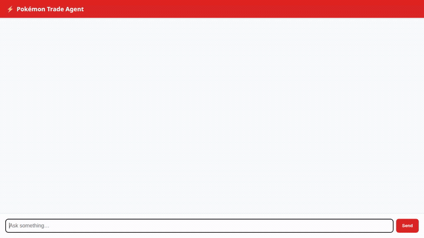

# Pokémon Trade Assistant (pokemon-trade-agent)

An intelligent conversational trading assistant and collection manager for Pokémon Trading Card Game (TCG) collectors, built with the Google Agent Development Kit (ADK) and deployed to Google Cloud Agent Platform.



---

## What the Agent Does

The assistant interacts directly with card collectors to inspect collections, research cards, evaluate trade fairness, manage wishlists, generate custom card art, and run mathematical trade equity calculations:

- **Collection Inspection & Catalog Search**: Queries real-time card records stored in Google Cloud Firestore (`pokemon_cards` collection) to retrieve card details, conditions, estimated market values, and trade availability.
- **Trade Fairness Evaluation**: Analyzes proposed trades comparing offered cards against requested cards, computing net value differential (USD) and value equity ratios.
- **Official Pokémon TCG Card Lookup**: Searches official Pokémon TCG card printings, variants, and high-resolution card artwork via the external TCGdex API.
- **Collector Wishlist Management**: Tracks, adds, lists, and removes target cards with priority ratings and target purchase/trade prices in Firestore (`collector_wishlist`).
- **Trade Offer Sheet Generation**: Generates formal trade tickets logged into Firestore (`trade_offers`) with agreed shipping terms and fairness metrics.
- **Custom Card Artwork Generation**: Creates custom card artwork using the `gemini-3.1-flash-lite-image` model, stores the result as an ADK artifact, and uploads the image to Google Cloud Storage with a public link.
- **Python Code Execution Sandbox**: Runs Python code inside a secure Agent Engine Sandbox Environment (`AgentEngineSandboxCodeExecutor`) for trade equity and statistical calculations.
- **Interactive UI Cards (A2UI v0.8)**: Emits rich display UI components (Cards, Columns, Rows, and Text with typography hints) rendered natively in the ADK Dev Web UI and web chat interface.
- **Cross-Session Long-Term Memory**: Persists collector preferences, favorite Pokémon, and conversation facts across sessions using Vertex AI Memory Bank (`PreloadMemoryTool` + session extraction callback).

---

## Google Cloud Services & Technologies Wired Up

| Service / Tool | Implementation Details in Code |
| :--- | :--- |
| **Agent Runtime** | Google Agent Development Kit (ADK) agent with Gemini 2.5 Flash model |
| **Firestore** | Stores `pokemon_cards`, `collector_wishlist`, and `trade_offers` collections |
| **Cloud Storage** | Stores generated card artwork in a dedicated GCS bucket |
| **Vertex AI Memory Bank** | Agent Engine Memory Bank for long-term memory extraction and retrieval |
| **Agent Engine Code Sandbox** | `AgentEngineSandboxCodeExecutor` for executing Python code in a secure sandbox |
| **Imagen on Vertex AI** | `gemini-3.1-flash-lite-image` for generating collectible card artwork |
| **A2UI (Agent-to-UI)** | `A2uiSchemaManager` (v0.8) and `a2ui_callback` rendering rich cards |
| **A2A Protocol** | Agent-to-Agent communication protocol used by the proxy frontend |

*(Note: BigQuery market trend analytics mentioned in early project planning was not implemented.)*

---

## Repository Structure

```
├── app/
│   ├── agent.py           # Core ADK agent, tools, schema, and callbacks
│   ├── a2ui_utils.py      # A2UI response formatting callback
│   └── fast_api_app.py    # ADK FastAPI application entrypoint
├── frontend/
│   ├── main.py            # FastAPI proxy communicating via A2A client
│   ├── requirements.txt   # Frontend dependencies
│   ├── Dockerfile         # Container definition for frontend deployment
│   └── static/
│       └── index.html     # Rebranded chat UI with embedded A2UI card renderer
├── agents-cli-manifest.yaml
├── Dockerfile             # Agent container definition for Cloud Build / Agent Engine
└── demo.gif               # Looping demo recording of the assistant in action
```

---

## Local Setup & Run Instructions

### Prerequisites
- Python 3.11+
- Google Cloud SDK (`gcloud`) authenticated with Application Default Credentials:
  ```bash
  gcloud auth login
  gcloud auth application-default login
  ```
- `uv` package manager (`pip install uv`)

### 1. Run the Agent Locally (ADK Web UI)

From the project root:

```bash
# Install dependencies
uv sync

# Launch the ADK Web playground with memory service enabled
uv run adk web . --port 8080 --reload_agents --memory_service_uri=agentengine://<YOUR_AGENT_ENGINE_ID>
```

### 2. Run the Custom Chat Frontend Locally

From the `frontend/` directory:

```bash
cd frontend

# Set up virtual environment and install dependencies
python3 -m venv .venv
source .venv/bin/activate
pip install -r requirements.txt

# Configure your deployed Agent Engine resource name
export AGENT_ENGINE_RESOURCE_NAME="projects/<PROJECT_NUMBER>/locations/<REGION>/reasoningEngines/<ENGINE_ID>"
export AGENT_DIRECTORY="app"

# Start the frontend server on port 8080
python main.py
```
